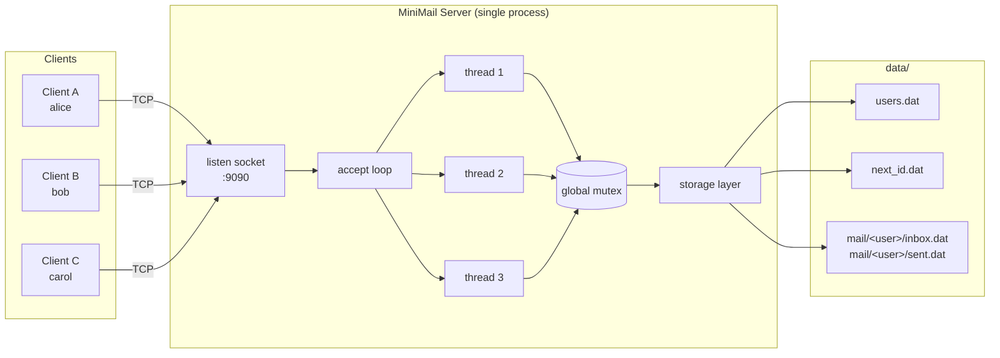
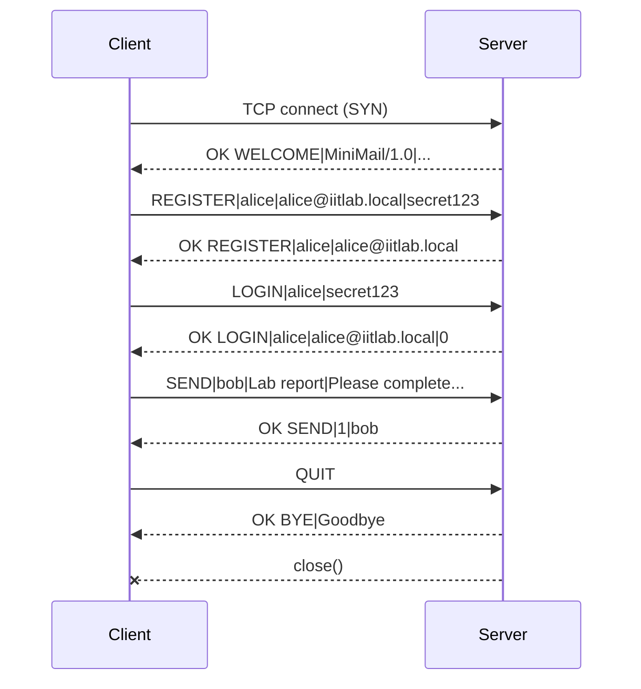
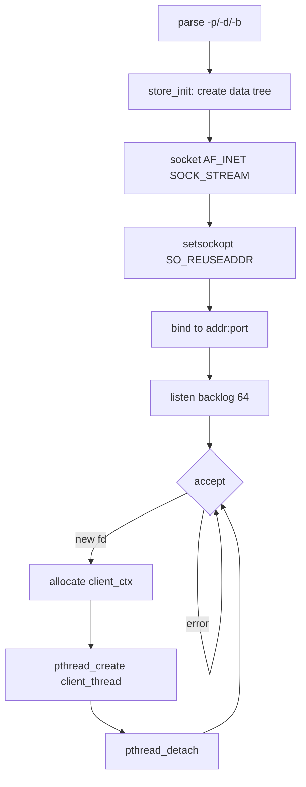
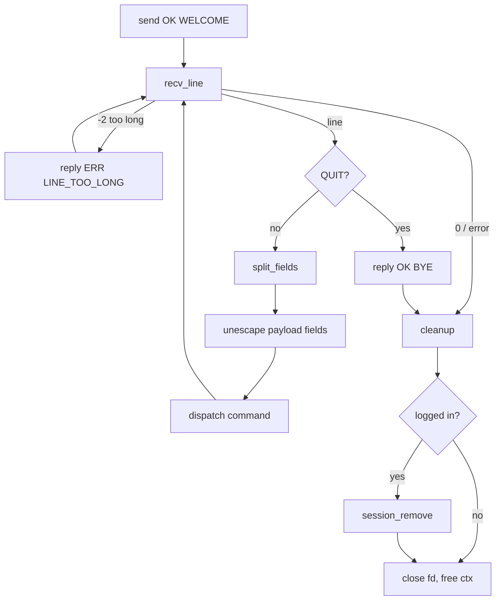
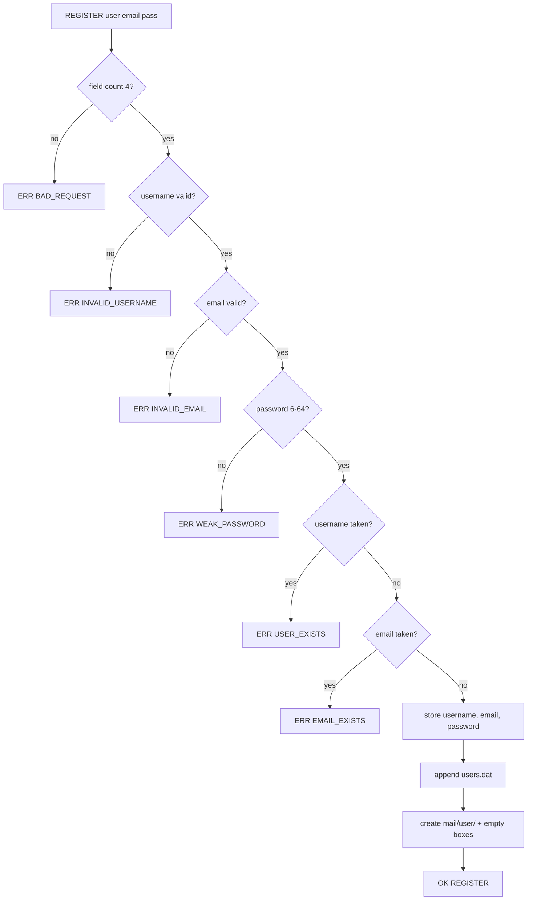
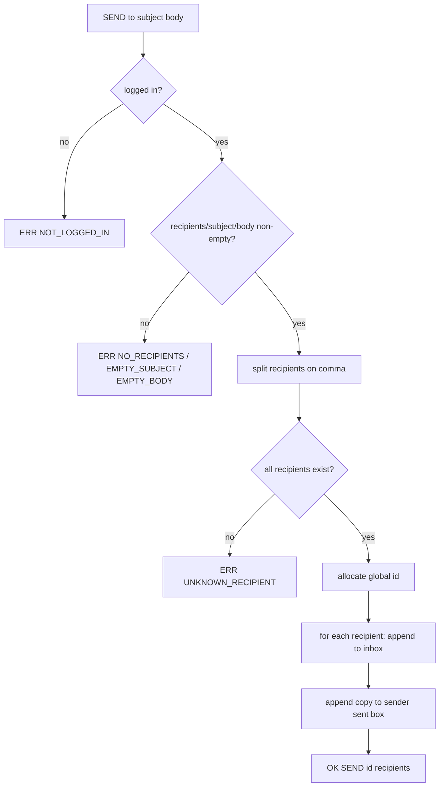

# MiniMail — Project Report

**Design and Development of a Multi-Client Email Service Using C and Network Socket Programming**

Internet Technology Laboratory — Individual Assignment
B.Tech. Information Technology

---

## 1. Introduction

Electronic mail is one of the oldest and most durable applications on the
Internet. Its core idea is simple: a user hands a message to a server, the server
stores it, and the intended recipient later asks the server for it. Everything
else — addressing, headers, folders, attachments — is elaboration on that
store-and-forward model.

This project implements that core idea from scratch in C, using only the BSD
socket API. The result, **MiniMail**, is a working multi-user email service: a
single server process that many clients connect to over TCP, register accounts,
authenticate, send messages to one or more recipients, and read their mail. All
state survives server restarts because it is written to plain files.

The point is not to compete with Gmail. The point is to make every layer
visible: the byte stream on the wire, the framing that turns it into requests,
the concurrency that lets several clients talk at once, and the file layout that
makes the data durable.

---

## 2. Problem Statement

Design and implement a miniature email service in C consisting of:

* a **central server** that listens on a configurable TCP port, accepts multiple
  concurrent clients, registers and authenticates users, stores and delivers
  mail, and keeps running when a client misbehaves or disconnects; and
* a **client** that connects to the server, registers, logs in, composes and
  sends mail to one or more recipients, lists and reads received mail, lists
  sent mail, and logs out.

The system must define its own application-layer protocol, persist data across
connections, and handle errors gracefully rather than crashing.

---

## 3. Objectives

1. Apply the client–server model to a realistic application.
2. Create TCP server and client programs using `socket()`, `bind()`, `listen()`,
   `accept()`, `connect()`, `send()`, `recv()` and `close()`.
3. Design and document a simple, robust application-layer protocol.
4. Handle multiple clients concurrently and explain the chosen mechanism.
5. Implement registration and authentication with persistent credentials.
6. Persist users and mail to disk and reload them after restart.
7. Implement the mandatory mail operations: send, inbox, read, sent.
8. Handle network and application errors without terminating the server.
9. Test the distributed application systematically and record the evidence.
10. Use an LLM as a programming assistant while verifying every suggestion.

---

## 4. System Architecture



The server is a single process with one listening socket. The main thread runs
the `accept()` loop; each accepted connection is handed to a newly created
detached POSIX thread. All threads share one mutex that guards the storage layer
and the active-session table.

---

## 5. Client–Server Architecture

### 5.1 Server responsibilities

| Responsibility | Where |
|---|---|
| Create/bind/listen on a configurable port | `main()` in [server.c](../server.c) |
| Accept connections and spawn a handler | `main()` accept loop |
| Send the welcome banner | `client_thread()` |
| Read and dispatch request lines | `client_thread()` → `handle_line()` |
| Register / authenticate users | `cmd_register()`, `cmd_login()` |
| Store and deliver mail | `cmd_send()` |
| List and read mail | `cmd_inbox()`, `cmd_sent()`, `cmd_read()` |
| Track active sessions | `session_add()`, `session_remove()` |
| Survive client errors | `SIGPIPE` ignored, per-connection error paths |
| Log activity | `log_msg()` |

### 5.2 Client responsibilities

| Responsibility | Where |
|---|---|
| Resolve and connect to the server | `connect_to()` in [client.c](../client.c) |
| Read the banner | `main()` |
| Present the menu | `print_menu()` |
| Register / log in / log out | `do_register()`, `do_login()`, `do_logout()` |
| Compose and send mail | `do_send()`, `prompt_body()` |
| List inbox / sent | `print_mail_table()` |
| Read a message | `do_read()` |
| Delete a message | `do_delete()` |
| Close the connection cleanly | `QUIT` handling in `main()` |

### 5.3 Connection lifecycle



---

## 6. Network Protocol Design

The full specification is in [docs/PROTOCOL.md](PROTOCOL.md); the essentials:

* **Line-oriented text protocol over TCP.** One request per line, one response
  per line, `\n` terminated, optional `\r` stripped.
* **`|` separates fields.** Literal `|`, `\`, CR and LF inside a field are
  escaped as `\p`, `\\`, `\r`, `\n`, so subjects and bodies may contain any text
  without breaking framing.
* **Responses are `OK <CODE>|...` or `ERR <CODE>|message`.** Clients branch on
  the code, not the human-readable text.
* **Multi-line results** (`INBOX`, `SENT`) use a header, one `M|...` line per
  record, and an `END` terminator.
* **Maximum line: 16 384 bytes.** Oversized lines are drained and rejected with
  `ERR LINE_TOO_LONG`; the connection remains usable.
* **Commands:** `REGISTER`, `LOGIN`, `LOGOUT`, `SEND`, `INBOX`, `SENT`, `READ`,
  `DELETE`, `STATS`, `WHOAMI`, `PING`, `HELP`, `QUIT`.

Why this design:

* **Text, not binary** — trivially debuggable with `nc`; no endianness or struct
  padding issues; a demo can be typed by hand.
* **Line framing, not length prefixes** — the parser is a single `recv()` loop
  that stops at `\n`; no partial-message reassembly logic.
* **Escaping rather than a length-prefixed body** — keeps one request on one
  line, so the server never has to buffer a multi-line message.
* **Explicit error codes** — the client can distinguish "wrong password" from
  "no such user" from "storage failure" without string matching.

---

## 7. Data Storage Design

Storage is plain text, one record per line, under the data directory.

```
data/
├── users.dat                 username|email|password|created
├── next_id.dat               next global email id
└── mail/
    ├── alice/
    │   ├── inbox.dat         id|from|to|subject|date|read|body
    │   └── sent.dat
    └── bob/
        ├── inbox.dat
        └── sent.dat
```

**Users.** `users.dat` holds one line per account:
`username|email|password|created`. The password is stored as typed, so login is a
direct string comparison. This is a deliberate simplification for a teaching
project — it keeps the storage layer trivial to read and explain, at the cost of
real-world security (see §16).

**Mail.** Each user has an inbox and a sent box. A record is
`id|from|to|subject|date|read|body`, with every free-text field escaped. The
`id` is globally unique, allocated from `next_id.dat` so ids never collide across
users.

**Delivery.** `SEND` validates every recipient first, then writes one copy into
each recipient's inbox and one copy into the sender's sent box. Because
validation happens before any write, a bad recipient cannot leave a partial
delivery.

**Updates.** Marking read and deleting rewrite the box to a temporary file and
`rename()` it over the original, so a crash mid-write cannot corrupt a mailbox.

**Why files, not a database.** The assignment permits file storage, and files
make the data inspectable during a viva: `cat data/mail/bob/inbox.dat` shows
exactly what the server holds. The trade-off is linear scans, which is acceptable
at this scale.

---

## 8. Algorithms and Flowcharts

### 8.1 Server main loop



### 8.2 Per-client thread



### 8.3 Registration



### 8.4 Send



---

## 9. Implementation

### 9.1 Files

| File | Lines | Role |
|---|---|---|
| [server.c](../server.c) | ~640 | accept loop, threads, command handlers |
| [client.c](../client.c) | ~470 | menu, request building, response rendering |
| [protocol.c](../protocol.c) | ~230 | `send_line`, `recv_line`, escaping, validation |
| [storage.c](../storage.c) | ~390 | users and mailboxes on disk |
| [common.h](../common.h) | ~70 | shared limits and prototypes |

### 9.2 Key functions

**`recv_line()`** — reads one byte at a time until `\n`, strips a trailing `\r`,
NUL-terminates, and returns `1` (line), `0` (peer closed), `-1` (socket error) or
`-2` (line too long). On overflow it keeps draining to the newline so the stream
stays synchronised — this is why the connection survives an oversized request.

**`proto_escape()` / `proto_unescape_inplace()`** — encode and decode `\`, `|`,
CR and LF. The in-place variant is used on the server because decoding never
grows a string.

**`split_fields()`** — replaces `|` with `\0` in place and fills a pointer array.
No allocation, no copying.

**`store_find_user()`** — linear scan of `users.dat`, parsing each line into a
`user_record`.

**`rewrite_box()`** — the shared engine for mark-read and delete: read each
record, apply a filter callback, write survivors to `<box>.dat.tmp`, then
`rename()`.

**`cmd_send()`** — validates the session, the field count, the recipient list and
every recipient's existence, then allocates an id and writes the copies. All of
this happens under the global mutex so two concurrent sends cannot interleave
their writes.

### 9.3 Credential storage

```c
snprintf(u.password, sizeof(u.password), "%s", f[3]);   /* REGISTER */
...
if (strcmp(f[2], u.password) != 0) {                    /* LOGIN    */
    reply(c->fd, "ERR BAD_PASSWORD|Incorrect password");
```

Passwords are stored as plain text and compared with `strcmp()`. No hashing, no
salting, no crypto library — the storage layer stays a few dozen lines and
`users.dat` can be read directly during a demonstration. The trade-off is
explicit: anyone with read access to the data directory learns every password,
and passwords cross the network unencrypted. §16 records this as a known
weakness and §17 lists hashing as the first security enhancement.

---

## 10. Multi-Client Handling

### 10.1 Mechanism chosen: thread per client (pthreads)

The server calls `accept()` in a loop and, for each connection, creates a
detached POSIX thread running `client_thread()`. Each thread blocks in
`recv_line()` on its own socket, so a slow or idle client never delays another.

### 10.2 Why this mechanism

| Option | Verdict |
|---|---|
| **Thread per client** | **Chosen.** Blocking code reads top-to-bottom; one thread per connection is the natural mapping; the OS scheduler handles interleaving; `pthread` is available everywhere. |
| `select()` / `poll()` | Would avoid threads, but every handler becomes a state machine, and the code becomes much harder to explain in a viva. Also limited by `FD_SETSIZE` for `select()`. |
| `fork()` per client | Simple isolation, but expensive per connection and awkward for shared state (each process would need its own locking or IPC). |
| Event loop + `epoll` | Best scalability, worst readability for a teaching project. |

The workload is I/O-bound and low-volume, so thread-per-client is the right
trade-off between clarity and concurrency. The cost — one stack per connection —
is bounded by `MAX_CLIENTS` (128).

### 10.3 Shared state and locking

Two things are shared across threads:

1. **The storage layer** (`users.dat`, `next_id.dat`, mailbox files).
2. **The active-session table** (`g_active[]`).

Both are protected by a single global mutex, `g_lock`. The critical sections are
short (file append, file scan, array update), so contention is negligible at this
scale. A single mutex also removes any chance of lock-ordering deadlock.

### 10.4 Session rules

`session_add()` rejects a second login for an account that is already active,
returning `ERR ALREADY_ACTIVE`. The session is released by `LOGOUT`, by `QUIT`,
or by the cleanup path at the end of `client_thread()` — which runs on abrupt
disconnects too, so a killed client cannot lock its account out permanently.

### 10.5 Robustness

* `SIGPIPE` is ignored, so writing to a closed socket returns `EPIPE` instead of
  killing the process.
* Every `send()`/`recv()` error path closes only that client's socket.
* `pthread_create()` failure closes the accepted fd and frees the context.
* `SIGINT`/`SIGTERM` set a stop flag and close the listening socket, so the
  accept loop exits cleanly.

---

## 11. Test Cases

The full table with inputs, expected outputs and observed results is in
[docs/TEST_RESULTS.md](TEST_RESULTS.md). Summary of coverage:

| Area | Cases |
|---|---|
| Registration (valid, duplicate username, duplicate e-mail, bad username, bad e-mail, weak password, missing fields) | 10 |
| Authentication (valid, wrong password, unknown user, double login, concurrent login, login after logout) | 6 |
| Authorisation guards | 2 |
| Sending (single, multiple, unknown recipient, empty subject/body/recipients, over-long subject/recipient, special characters, too many fields) | 10 |
| Inbox and reading (listing, record shape, unread flags, read, body integrity, escaping, read transitions, bad ids) | 11 |
| Sent mail and statistics | 5 |
| Deletion | 3 |
| Protocol robustness (unknown command, empty line, ping, help, oversized line, recovery, bad escape) | 7 |
| Concurrency (three simultaneous clients) | 6 |
| Session and persistence | 5 |
| **Automated total** | **65** |
| Manual interactive client tests | 9 |
| Manual error-handling tests | 8 |

---

## 12. Test Results

```
$ make test
== Building ==
== Protocol / functional tests (port 9191) ==
[PASS] welcome banner
[PASS] register alice
...
[PASS] inbox persisted

65/65 checks passed

All automated tests passed.
```

All 65 automated checks, 9 manual interactive checks and 8 manual error-handling
checks passed. The server did not crash or exit during any test, including
malformed requests, a 20 000-byte line, binary garbage, and abrupt disconnects
while logged in.

Notable verified behaviours:

* A subject containing `|` and a body containing newlines and `|` round-trip
  exactly (`Lab report | final`, `Line one\nLine two with a | pipe`).
* Reading a message flips only that message's unread flag.
* Three clients logged in simultaneously can each send and receive.
* Killing a client while logged in releases the session; the account can log in
  again immediately.
* Mail and accounts survive a client reconnect and a server restart.

---

## 13. Screenshots

Screenshots are captured from the live system during the demonstration. The
transcripts below are the exact terminal output of the runs recorded in
[docs/TEST_RESULTS.md](TEST_RESULTS.md).

**Server startup and activity log**

```
[2026-11-02 07:46:31] MiniMail server MiniMail/1.0 listening on 0.0.0.0:9301 (data: /tmp/mmdata)
[2026-11-02 07:46:31] CONNECT 127.0.0.1:38590
[2026-11-02 07:46:31] REGISTER ok user=alice email=alice@iitlab.local
[2026-11-02 07:46:31] LOGIN ok user=alice from 127.0.0.1:38590
[2026-11-02 07:46:33] SEND id=1 from=alice to=bob
[2026-11-02 07:46:33] LOGOUT user=alice
[2026-11-02 07:46:33] QUIT 127.0.0.1:38590
```

**Client: send mail**

```
Choice: 3
To (comma separated usernames): bob
Subject: Lab report | final
Message body (end with a single '.' on its own line):
> Line one
> Line two with a | pipe
> .
[+] Message sent (id 1) to bob.
```

**Client: sent mail**

```
-------- SENT MAIL --------
ID    TO           SUBJECT                      DATE                 STATUS
1     bob          Lab report | final           2026-11-02 07:46:33  -
1 message(s)
```

**Client: inbox (recipient)**

```
-------- INBOX --------
ID    FROM         SUBJECT                      DATE                 STATUS
1     alice        Lab report | final           2026-11-02 07:46:33  UNREAD
1 message(s)
```

**Client: read a message**

```
Message ID: 1
============================================================
ID      : 1
From    : alice
To      : bob
Subject : Lab report | final
Date    : 2026-11-02 07:46:33
------------------------------------------------------------
Line one
Line two with a | pipe
============================================================
```

**On-disk state**

```
$ cat data/users.dat
alice|alice@iitlab.local|secret123|2026-11-02 07:51:22
bob|bob@iitlab.local|secret123|2026-11-02 07:51:22

$ cat data/mail/bob/inbox.dat
1|alice|bob|Lab report \p final|2026-11-02 07:46:33|1|Line one\nLine two with a \p pipe
```

---

## 14. AI/LLM Usage

An LLM assistant was used throughout, as permitted by the assignment. The
detailed log is in [docs/AI_USAGE_LOG.md](AI_USAGE_LOG.md). In summary:

* **Used for:** explaining socket API semantics, reviewing the protocol design,
  drafting the escaping scheme, generating the initial test matrix, and reviewing
  error paths.
* **Verified by:** compiling with `-Wall -Wextra -Wpedantic`, running the 65-check
  automated suite, and manual interactive testing.
* **One real bug found and fixed during verification:** the first version escaped
  outgoing fields on the client but never unescaped them on the server, so a
  subject containing `|` was silently split into extra fields. The automated test
  `escaped body round-trips` caught it; the fix was to add
  `proto_unescape_inplace()` and apply it to every payload field in
  `handle_line()`. This is exactly the kind of assumption an LLM-generated
  snippet can get wrong, and why the tests matter.

---

## 15. Limitations

* **No transport encryption.** Passwords and message bodies cross the network in
  plaintext. Anyone able to sniff the connection can read them.
* **Plaintext passwords.** `users.dat` stores passwords as typed. Anyone who can
  read the file learns every credential, and there is no protection if the file
  leaks.
* **Single global mutex.** Correct, but a scalability bottleneck; a per-mailbox
  lock or a real database would be needed for many users.
* **Thread per client.** Memory grows with connections; no thread pool, no idle
  timeout, no per-client rate limiting.
* **One active session per account.** A user cannot be logged in from two
  machines at once.
* **Linear file scans.** Every `INBOX` reads the whole box file; no indexes.
* **Size limits.** 4 KB body, 16 KB line, 10 recipients, 128 concurrent clients.
* **No push delivery.** Mail appears on the recipient's next `INBOX` request;
  there is no notification channel.
* **No attachments, CC/BCC, folders, forwarding, search, or password reset.**
* **IPv4-only bind address** (`-b`); the client itself can resolve IPv6.
* **No account lockout** after repeated failed logins.

---

## 16. Security Considerations

**Implemented**

* Passwords are stored in plain text in `users.dat`. This is a deliberate
  simplification, not an oversight: it is the single largest security weakness
  in the system and is called out here and in §15.
* All input is length-checked and validated before use: username charset,
  e-mail shape, password length, body size, recipient count.
* Field escaping prevents protocol injection — a subject containing `|` or a
  newline cannot forge extra fields or extra requests.
* `SIGPIPE` is ignored so a vanished peer cannot terminate the server.
* Storage writes are flushed and error-checked; mailbox updates use
  write-temp + `rename()` for atomicity.
* Session state is released on abrupt disconnect, preventing permanent lockout.
* The server never executes client-supplied data and never builds shell commands
  from it.

**Not implemented (documented as future work)**

* TLS for confidentiality and integrity.
* Password hashing (bcrypt/Argon2) with per-user random salts.
* Rate limiting and account lockout against online guessing.
* Audit logging of failed authentication attempts.
* Server-side spam or content filtering.

**Threat model note.** MiniMail is an educational system intended for a trusted
lab network. It should not be exposed to the public Internet in its current form.

---

## 17. Future Enhancements

1. **TLS** via OpenSSL, with a self-signed certificate for the lab.
2. **bcrypt/Argon2** password hashing with per-user salts.
3. **Thread pool** with a bounded queue, plus idle timeouts.
4. **SQLite** backend with indexes on `(owner, box, id)`.
5. **Push notification**: a second connection or a long-poll `WAIT` command so
   new mail appears without polling.
6. **Attachments** with a length-prefixed binary transfer command.
7. **Folders, CC/BCC, forwarding, search** by sender/subject/date.
8. **Account management**: password change, account deletion, admin commands.
9. **Rate limiting and lockout** after N failed logins.
10. **IPv6 bind support** and a config file instead of flags.
11. **Structured logging** (JSON lines) and a metrics endpoint.
12. **A curses or GUI client** for a nicer demonstration.

---

## 18. Conclusion

MiniMail demonstrates, end to end, how a real Internet application is built from
primitives. A TCP socket carries a byte stream; a small line-oriented protocol
with explicit escaping turns that stream into typed requests and responses; a
thread per connection lets many users work at once; a mutex keeps shared files
consistent; and a simple on-disk layout makes the data durable and inspectable.

Every mandatory requirement of the assignment is met: configurable port,
concurrent clients, registration with duplicate detection, authentication with
distinct error responses, sending to one or more validated recipients, inbox
listing with id/sender/subject/date/read status, full message reading, sent-mail
listing, logout, persistent storage, graceful error handling, a documented
protocol, a README, a test suite with recorded results, and this report.

The most valuable lesson was not writing the socket code — that is a handful of
well-documented calls — but designing the protocol so that arbitrary user text
cannot break it, and then proving that with tests. The escaping bug found during
verification is a concrete example: the design looked right, the code compiled,
and only a test that sent a `|` inside a subject revealed the gap.

---

## 19. References

1. W. R. Stevens, B. Fenner, A. M. Rudoff, *UNIX Network Programming, Volume 1:
   The Sockets Networking API*, 3rd ed., Addison-Wesley, 2003.
2. J. F. Kurose, K. W. Ross, *Computer Networking: A Top-Down Approach*, 8th ed.,
   Pearson, 2021.
3. IEEE Std 1003.1-2017 (POSIX.1), *System Interfaces* — `socket`, `bind`,
   `listen`, `accept`, `connect`, `send`, `recv`, `pthread_create`.
4. R. Fielding et al., *RFC 7230: Hypertext Transfer Protocol (HTTP/1.1):
   Message Syntax and Routing*, IETF, 2014 — line framing and header conventions.
5. J. Klensin, *RFC 5321: Simple Mail Transfer Protocol*, IETF, 2008 — the
   store-and-forward model this project miniaturises.
6. Linux man-pages project, `man 7 socket`, `man 3 pthread_create`,
   `man 2 rename`.
